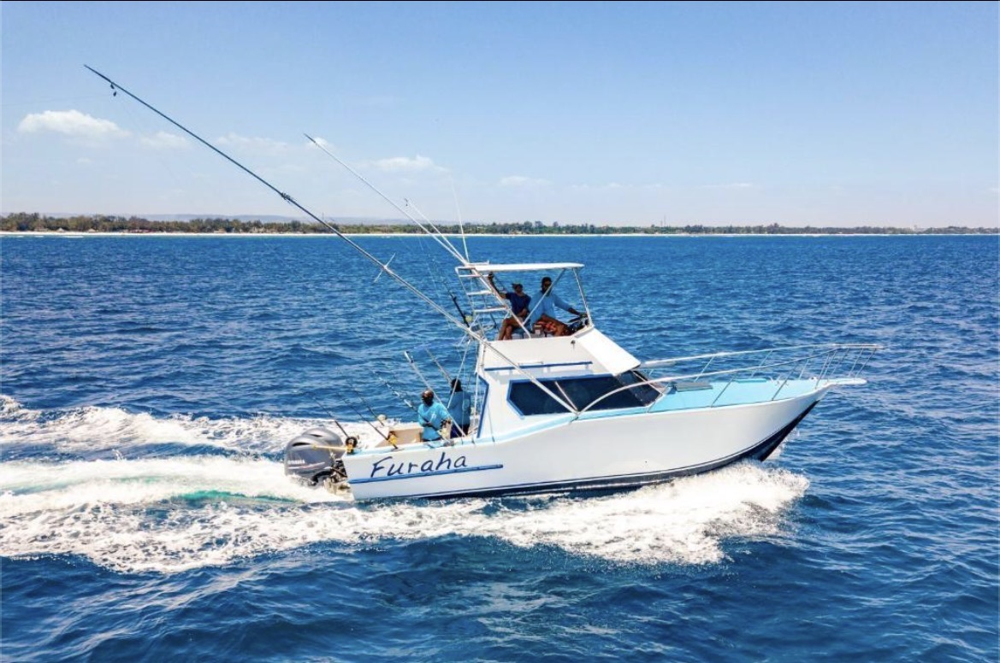

<!DOCTYPE html>
<html lang="en">
<head>
    <meta charset="UTF-8">
    <meta name="viewport" content="width=device-width, initial-scale=1.0">

    <title>Products - Kenya Marine Supplies Ltd</title>

    
</head>

<body>

    <header>
        <h1>KENYA MARINE SUPPLIES</h1>
        
Your Trusted Maritime Equipment Supplier

    </header>

    <nav>
        <a href="index.html">Home</a>
        <a href="products.html">Products</a>
        <a href="contact.html">Products and Services</a>
    </nav>

    <section class="intro">
        <h2>Our Marine Products</h2>

        

            We provide essential marine equipment and supplies
            to support safe and efficient maritime operations.
            Explore our products and services for ships, crew
            members and port operations.
        

    </section>

    <section class="products">

        

            

            <h3>1. Marine Transportation</h3>

            

                Marine transportation involves moving goods
                and passengers using ships and other water
                vessels. It supports international trade and
                connects businesses across different countries.
            

        

        

            

            <h3>2. Cargo Ships and Shipping</h3>

            

                Cargo ships transport goods such as containers,
                machinery, food and other materials across the
                sea. They play an important role in international
                trade and the delivery of products.
            

        

        

            

            <h3>3. Marine Equipment and Supplies</h3>

            

                Marine equipment includes ropes, anchors,
                navigation devices and safety equipment.
                These supplies help vessels operate safely
                and efficiently during maritime activities.
            

        

        

            

            <h3>4. Port Operations and Services</h3>

            

                Port operations include loading and unloading
                cargo, storing goods and assisting vessels
                at the port. Efficient port services support
                smooth shipping and maritime trade.
            

        

    </section>

    <footer>
        
&copy; 2026 Kenya Marine Supplies Ltd. All rights reserved.

    </footer>

</body>
</html>
